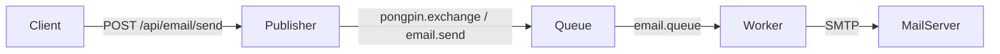

# Architecture

Pongpin has two Spring Boot applications. The publisher accepts email requests and provides the configuration dashboard. The worker consumes requests and sends the email through SMTP.

## Event flow

## Scaling 

Run multiple worker processes with the same `Applications.yml` configuration and queue name.

### RMQ 
You may spawn multiple workers and RMQ, will concurrently pass on messages to the workers. This turned out ot perform exceptionally well in testing. 

### KAFKA
Kafka allows only one consumer per topic per partition. thus one needs to increase the number of partition to increase the concurrently. Kafka is specifically introduced for use cases which require 3rd party integration to this infra which involved interacting with the queue.

## Limitations
Currently we do not suport a Dead letter queue, thus a failed consumption will break the worker, thus one should take this in consideration while integrating. 